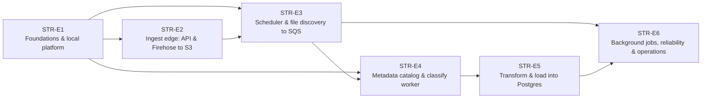

# Stratum board

A file-based, Jira-style board for Stratum. **Each `main.json` is the source of truth.** This README is a generated snapshot (2026-11-16) and doesn't update itself when you change a status. Story STR-109 builds a CLI that renders a live board from these files.

Architecture: [docs/architecture.md](../docs/architecture.md). AWS stand-ins: [docs/aws-alternatives.md](../docs/aws-alternatives.md).

## Layout

```
Epic/
├── README.md                      # this file
├── definition-of-done.json        # applies to every story
├── definition-of-ready.json       # gate for pulling a story into a sprint
└── E<n>-<epic-slug>/
    ├── main.json                  # the epic: goal, success criteria, story list, points
    └── Stories/
        └── STR-<nnn>-<story-slug>/
            ├── main.json          # the story
            └── T<n>-<task-slug>.json   # sub-tasks (stories of 5+ points)
```

Story keys encode their epic: `STR-2xx` belongs to `STR-E2`, and so on.

## Story `main.json` fields

| Field | Meaning |
|---|---|
| `key, type, epic` | Jira-style identity. `epic` points at the parent epic key. |
| `status` | `Backlog` → `To Do` (in a sprint) → `In Progress` → `In Review` (PR open) → `Done` |
| `sprint` | `"Sprint N"` once planned, otherwise `null` |
| `priority` | Highest / High / Medium / Low |
| `story_points` | Fibonacci 1, 2, 3, 5, 8 (13 means split it) |
| `aws_equivalent` | The AWS service this story mimics, if any |
| `user_story` | As a / I want / so that |
| `acceptance_criteria` | Given / When / Then, with ids AC1..n (reference them in PRs) |
| `rust_concepts` | What you will learn or practise; skim these before starting |
| `technical_notes` | Gotchas and decisions already made |
| `dependencies` | `blocked_by` and `blocks` (story keys) |
| `definition_of_done` | Inherits the global DoD plus story-specific extras |
| `tasks` | File names of the sub-task JSONs in the same folder |
| `references` | Docs to read; Rust Book chapters first |
| `activity` | Append `{date, by, note}` entries as the story moves (a lightweight history) |

## Workflow

1. **Sprint planning:** pick stories whose blockers are Done (see *Wave* below), check them against the Definition of Ready, and set `sprint` and `status: "To Do"`.
2. **Start:** `git switch -c story/STR-204-firehose-buffer-core` and set status `In Progress`.
3. **Build:** work through the task JSONs, ticking `checklist[].done`.
4. **Review:** open a PR titled `STR-204: <title>`, set status `In Review`, and ask Claude for a `/code-review`.
5. **Done:** merge once the Definition of Done is satisfied, set status `Done`, and add an `activity` entry.

## Estimation

Points measure relative effort **including learning time**. Rust is new, so early stories carry extra learning. Rough feel:

| Points | Feels like |
|---|---|
| 1 | under 2 hours, mostly following instructions |
| 2 | an evening |
| 3 | one or two sessions; one new concept |
| 5 | several sessions; a couple of new concepts plus tests |
| 8 | about a week of evenings; several interacting concepts (should have tasks) |

Total backlog: **184 points** across 41 stories. Velocity is unknown until Sprint 1 ends; re-plan after measuring it.

## Epics

| Epic | Title | Stories | Points | Depends on |
|---|---|---|---|---|
| [STR-E1](E1-foundations-and-local-platform/main.json) | Foundations & local platform | 9 | 27 | — |
| [STR-E2](E2-ingest-edge/main.json) | Ingest edge: API & Firehose to S3 | 8 | 35 | STR-E1 |
| [STR-E3](E3-scheduler-and-file-discovery/main.json) | Scheduler & file discovery to SQS | 6 | 24 | STR-E1, STR-E2 |
| [STR-E4](E4-metadata-catalog-and-classification/main.json) | Metadata catalog & classify worker | 6 | 36 | STR-E1, STR-E3 |
| [STR-E5](E5-transform-and-load/main.json) | Transform & load into Postgres | 5 | 31 | STR-E4 |
| [STR-E6](E6-background-jobs-and-operations/main.json) | Background jobs, reliability & operations | 7 | 31 | STR-E3, STR-E5 |



## Proposed Sprint 1 (17 points)

Getting the toolchain, workspace, local stack and core types in place unblocks almost everything else. Confirm or adjust it in sprint planning.

- **STR-101**: Install Docker Engine & Compose in WSL2 (1 pt)
- **STR-102**: Convert the repo into a Cargo workspace with crate skeletons (3 pts)
- **STR-103**: Local AWS stand-ins with Docker Compose (5 pts)
- **STR-104**: Spike: AWS SDK for Rust against the local stand-ins (3 pts)
- **STR-105**: Telemetry domain model in stratum-core (5 pts)

## All stories

**Wave** is the earliest step a story can start: wave 1 has no blockers, and wave *n* depends only on lower waves. Stories in the same wave can be done in any order.

### STR-E1: Foundations & local platform (27 pts)

By the end of this epic, `docker compose up` gives a working fake AWS on the laptop, the AWS SDK for Rust is proven against it, and the workspace has a shared domain model, config, errors, logging and CI.

| Key | Story | Pts | Priority | Wave | Blocked by | Status |
|---|---|---|---|---|---|---|
| [STR-101](E1-foundations-and-local-platform/Stories/STR-101-install-docker-in-wsl2/main.json) | Install Docker Engine & Compose in WSL2 | 1 | Highest | 1 | — | In Review (Sprint 1) |
| [STR-102](E1-foundations-and-local-platform/Stories/STR-102-cargo-workspace-skeleton/main.json) | Convert the repo into a Cargo workspace with crate skeletons | 3 | Highest | 1 | — | In Review (Sprint 1) |
| [STR-103](E1-foundations-and-local-platform/Stories/STR-103-local-aws-stack-docker-compose/main.json) | Local AWS stand-ins with Docker Compose | 5 | Highest | 2 | STR-101 | In Review (Sprint 1) |
| [STR-104](E1-foundations-and-local-platform/Stories/STR-104-spike-aws-sdk-rust-local/main.json) | Spike: AWS SDK for Rust against the local stand-ins | 3 | Highest | 3 | STR-102, STR-103 | To Do (Sprint 1) |
| [STR-105](E1-foundations-and-local-platform/Stories/STR-105-telemetry-domain-model/main.json) | Telemetry domain model in stratum-core | 5 | High | 2 | STR-102 | To Do (Sprint 1) |
| [STR-106](E1-foundations-and-local-platform/Stories/STR-106-config-and-error-conventions/main.json) | Configuration loading & error-handling conventions | 3 | High | 2 | STR-102 | Backlog |
| [STR-107](E1-foundations-and-local-platform/Stories/STR-107-tracing-baseline/main.json) | Structured logging baseline with tracing | 2 | Medium | 3 | STR-106 | Backlog |
| [STR-108](E1-foundations-and-local-platform/Stories/STR-108-ci-github-actions/main.json) | CI pipeline on GitHub Actions | 2 | Medium | 2 | STR-102 | Backlog |
| [STR-109](E1-foundations-and-local-platform/Stories/STR-109-board-cli/main.json) | Stretch: `stratum-cli board` to view this Epic/ folder as a sprint board | 3 | Low | 2 | STR-102 | Backlog |

### STR-E2: Ingest edge: API & Firehose to S3 (35 pts)

Telemetry sent over HTTP lands as gzip NDJSON files in `stratum-raw`, partitioned by hour, with backpressure under load and no data loss on shutdown.

| Key | Story | Pts | Priority | Wave | Blocked by | Status |
|---|---|---|---|---|---|---|
| [STR-201](E2-ingest-edge/Stories/STR-201-ingest-api-skeleton/main.json) | Ingest API skeleton: health, readiness & graceful shutdown | 3 | High | 4 | STR-106, STR-107 | Backlog |
| [STR-202](E2-ingest-edge/Stories/STR-202-telemetry-ingest-endpoint/main.json) | POST /v1/telemetry with per-record validation | 5 | High | 5 | STR-201, STR-105 | Backlog |
| [STR-203](E2-ingest-edge/Stories/STR-203-api-key-auth/main.json) | API-key authentication & tenant resolution | 3 | Medium | 6 | STR-202 | Backlog |
| [STR-204](E2-ingest-edge/Stories/STR-204-firehose-buffer-core/main.json) | Firehose: per-stream buffer with size/interval flush & gzip | 8 | High | 3 | STR-105, STR-106 | Backlog |
| [STR-205](E2-ingest-edge/Stories/STR-205-firehose-s3-delivery/main.json) | Firehose: S3 delivery with time-partitioned keys, retries & spool | 5 | High | 4 | STR-204, STR-104 | Backlog |
| [STR-206](E2-ingest-edge/Stories/STR-206-firehose-put-record-batch-api/main.json) | Firehose PutRecordBatch HTTP API, client & backpressure | 5 | High | 6 | STR-205, STR-202 | Backlog |
| [STR-207](E2-ingest-edge/Stories/STR-207-firehose-graceful-shutdown/main.json) | Firehose: flush everything on shutdown | 3 | High | 7 | STR-206 | Backlog |
| [STR-208](E2-ingest-edge/Stories/STR-208-load-generator-cli/main.json) | Load generator: `stratum-cli generate` | 3 | Medium | 6 | STR-202 | Backlog |

### STR-E3: Scheduler & file discovery to SQS (24 pts)

A scheduler service runs cron jobs exactly once even with two instances, and new raw files become ledger rows and queue messages within about a minute.

| Key | Story | Pts | Priority | Wave | Blocked by | Status |
|---|---|---|---|---|---|---|
| [STR-301](E3-scheduler-and-file-discovery/Stories/STR-301-postgres-access-and-migrations/main.json) | Postgres access layer & migrations (stratum schema) | 3 | High | 3 | STR-103, STR-106 | Backlog |
| [STR-302](E3-scheduler-and-file-discovery/Stories/STR-302-scheduler-core/main.json) | Scheduler core: cron jobs, run loop & run history | 8 | High | 4 | STR-301 | Backlog |
| [STR-303](E3-scheduler-and-file-discovery/Stories/STR-303-scheduler-single-runner-lock/main.json) | Single-runner guarantee with Postgres advisory locks | 3 | Medium | 5 | STR-302 | Backlog |
| [STR-304](E3-scheduler-and-file-discovery/Stories/STR-304-discover-raw-files-job/main.json) | Job: discover new raw files into the ledger | 5 | High | 5 | STR-302, STR-301, STR-205 | Backlog |
| [STR-305](E3-scheduler-and-file-discovery/Stories/STR-305-enqueue-discovered-files/main.json) | Enqueue discovered files to the raw-files queue | 3 | High | 6 | STR-304 | Backlog |
| [STR-306](E3-scheduler-and-file-discovery/Stories/STR-306-jobs-admin-cli/main.json) | Jobs admin CLI: list, history, run now | 2 | Low | 6 | STR-302, STR-303 | Backlog |

### STR-E4: Metadata catalog & classify worker (36 pts)

The worker consumes raw-files messages, stream-decodes each file, categorises every record (product_type, data_type) from the catalog, writes per-data_type staged files and transform messages, quarantines bad records and isolates poison files in the DLQ.

| Key | Story | Pts | Priority | Wave | Blocked by | Status |
|---|---|---|---|---|---|---|
| [STR-401](E4-metadata-catalog-and-classification/Stories/STR-401-metadata-catalog-and-seed/main.json) | Metadata catalog tables & seed CLI | 5 | High | 4 | STR-104, STR-105 | Backlog |
| [STR-402](E4-metadata-catalog-and-classification/Stories/STR-402-metadata-client-with-cache/main.json) | Metadata client with TTL cache & request coalescing | 5 | High | 5 | STR-401 | Backlog |
| [STR-403](E4-metadata-catalog-and-classification/Stories/STR-403-sqs-consumer-framework/main.json) | Reusable SQS consumer: polling, concurrency, heartbeats, shutdown | 8 | High | 4 | STR-104, STR-107 | Backlog |
| [STR-404](E4-metadata-catalog-and-classification/Stories/STR-404-raw-file-decoder/main.json) | Streaming decoder for gzip NDJSON files | 5 | High | 4 | STR-105, STR-104 | Backlog |
| [STR-405](E4-metadata-catalog-and-classification/Stories/STR-405-classify-and-route/main.json) | Classify handler: categorise records & route to staged batches | 8 | Highest | 7 | STR-402, STR-403, STR-404, STR-305 | Backlog |
| [STR-406](E4-metadata-catalog-and-classification/Stories/STR-406-quarantine-and-poison-handling/main.json) | Quarantine table & poison-file handling | 5 | High | 8 | STR-405 | Backlog |

### STR-E5: Transform & load into Postgres (31 pts)

Staged batches become rows in day-partitioned telemetry tables idempotently, and an automated end-to-end test proves the whole pipeline from HTTP to Postgres.

| Key | Story | Pts | Priority | Wave | Blocked by | Status |
|---|---|---|---|---|---|---|
| [STR-501](E5-transform-and-load/Stories/STR-501-telemetry-tables/main.json) | Day-partitioned telemetry tables | 5 | High | 4 | STR-301 | Backlog |
| [STR-502](E5-transform-and-load/Stories/STR-502-transformer-trait/main.json) | Transformer trait & one transformer per data_type | 8 | High | 3 | STR-105 | Backlog |
| [STR-503](E5-transform-and-load/Stories/STR-503-idempotent-batch-loader/main.json) | Idempotent bulk loader | 5 | High | 5 | STR-501, STR-502 | Backlog |
| [STR-504](E5-transform-and-load/Stories/STR-504-transform-worker-role/main.json) | Transform worker role | 5 | High | 8 | STR-403, STR-503, STR-405 | Backlog |
| [STR-505](E5-transform-and-load/Stories/STR-505-end-to-end-pipeline-test/main.json) | End-to-end pipeline test | 8 | High | 9 | STR-504, STR-207, STR-305 | Backlog |

### STR-E6: Background jobs, reliability & operations (31 pts)

The platform maintains itself (partitions, retention, rollups), heals stuck work, surfaces failures (DLQ depth, metrics), and starts entirely in containers.

| Key | Story | Pts | Priority | Wave | Blocked by | Status |
|---|---|---|---|---|---|---|
| [STR-601](E6-background-jobs-and-operations/Stories/STR-601-partition-maintenance-job/main.json) | Job: create upcoming partitions | 3 | High | 5 | STR-302, STR-501 | Backlog |
| [STR-602](E6-background-jobs-and-operations/Stories/STR-602-retention-cleanup-job/main.json) | Job: retention cleanup for Postgres and object storage | 3 | Medium | 6 | STR-601 | Backlog |
| [STR-603](E6-background-jobs-and-operations/Stories/STR-603-hourly-metrics-rollup-job/main.json) | Job: hourly metric rollups | 5 | Medium | 6 | STR-302, STR-503 | Backlog |
| [STR-604](E6-background-jobs-and-operations/Stories/STR-604-reconcile-files-job/main.json) | Job: reconcile stuck and missing files | 5 | High | 9 | STR-305, STR-504 | Backlog |
| [STR-605](E6-background-jobs-and-operations/Stories/STR-605-dlq-monitor-and-redrive/main.json) | DLQ monitoring job & redrive CLI | 5 | Medium | 7 | STR-403, STR-306 | Backlog |
| [STR-606](E6-background-jobs-and-operations/Stories/STR-606-prometheus-metrics/main.json) | Prometheus metrics for every service | 5 | Medium | 5 | STR-201, STR-403 | Backlog |
| [STR-607](E6-background-jobs-and-operations/Stories/STR-607-containerize-services/main.json) | Containerise all services | 5 | Low | 10 | STR-505 | Backlog |
