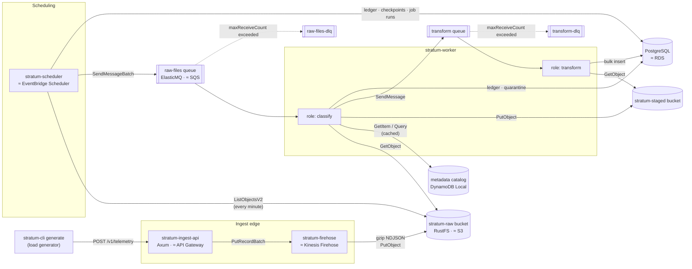

# Stratum architecture

Stratum is a set of Rust services that sit between **raw telemetry ingest** and the **platform data stores**. Telemetry arrives over HTTP and is buffered into compressed files in object storage. Those files are then discovered, decoded, classified with a metadata catalog, transformed, and loaded into PostgreSQL. A scheduler also runs background maintenance jobs.

Everything runs locally for free. See [aws-alternatives.md](aws-alternatives.md) for why each stand-in was chosen.

## Pipeline diagram



## Components

| Component | Kind | Responsibility |
|---|---|---|
| `stratum-core` | library | Domain types (envelope, `DataType`, `ProductType`), config loading, shared errors |
| `stratum-aws` | library | Builds S3/SQS/DynamoDB clients for **local or real AWS** from config (endpoint override, path-style, checksum mode) |
| `stratum-db` | library | Postgres pool, migrations, repositories (ledger, checkpoints, job runs, telemetry tables) |
| `stratum-ingest-api` | binary | HTTP ingest: auth, validation, partial-success responses, forwarding to Firehose |
| `stratum-firehose` | binary | Buffers records per stream, flushes on size/interval, gzips, writes to S3 with retries |
| `stratum-scheduler` | binary | Cron runner with single-runner locks and run history; hosts all scheduled jobs |
| `stratum-worker` | binary | SQS consumer with two roles: **classify** (raw to staged) and **transform** (staged to Postgres) |
| `stratum-cli` | binary | Developer/ops tool: seed metadata, generate load, run jobs on demand, redrive DLQs |

### Repository layout (target)

```
stratum/
├── Cargo.toml               # [workspace] (virtual manifest)
├── crates/
│   ├── stratum-core/
│   ├── stratum-aws/
│   ├── stratum-db/
│   ├── stratum-ingest-api/
│   ├── stratum-firehose/
│   ├── stratum-scheduler/
│   ├── stratum-worker/
│   └── stratum-cli/
├── migrations/              # sqlx migrations
├── deploy/                  # docker compose, ElasticMQ config, seed data
├── docs/
└── Epic/                    # the board: epics → stories → tasks
```

## Data model

### 1. Telemetry envelope (what clients send)

```json
{
  "event_id": "01934f7e-6a1b-7c3d-9e2f-0a1b2c3d4e5f",
  "source_id": "web-checkout",
  "name": "page_view",
  "occurred_at": "2026-11-16T10:00:00.123Z",
  "schema_version": 1,
  "attributes": { "env": "prod", "region": "ap-southeast-1" },
  "payload": { "user_id": "u-42", "session_id": "s-9", "properties": { "path": "/cart" } }
}
```

- `event_id`: a UUID (v7 recommended, since it's time-ordered) generated by the client. It's the **idempotency key** all the way to Postgres.
- `source_id` + `name`: the **catalog lookup key**. The client doesn't decide where data goes. The metadata catalog does.
- The ingest API adds `tenant_id` (from the API key) and `received_at` before forwarding.

### 2. Categories (decided by the metadata catalog)

| Field | Values | Decided by |
|---|---|---|
| `product_type` | `web`, `mobile`, `iot`, `backend` | `stratum-sources` table, by `source_id` |
| `data_type` | `metric`, `event`, `log` | `stratum-catalog` table, by `(source_id, name)` |

The payload contract for each `data_type`:

| `data_type` | Required payload fields | Target table |
|---|---|---|
| `metric` | `value` (number), `kind` (`gauge`\|`counter`), optional `unit`, `tags` | `telemetry.metrics` |
| `event` | `properties` (object), optional `user_id`, `session_id` | `telemetry.events` |
| `log` | `level` (`trace`…`error`), `message`, optional `logger`, `fields` | `telemetry.logs` |

### 3. Metadata catalog (DynamoDB Local)

| Table | Key | Attributes |
|---|---|---|
| `stratum-sources` | PK `source_id` | `product_type`, `tenant_id`, `display_name`, `status` (`active`\|`disabled`), `retention_days` |
| `stratum-catalog` | PK `source_id`, SK `name` | `data_type`, `schema_version`, `required_fields` (list), `drop_fields` (list, e.g. PII), `unit` (metrics) |

The worker caches lookups in memory with a TTL. An unknown source or name sends the record to **quarantine** and doesn't fail the file.

### 4. Object storage layout

| Bucket | Key pattern | Written by |
|---|---|---|
| `stratum-raw` | `raw/<stream>/year=YYYY/month=MM/day=DD/hour=HH/<stream>-<yyyyMMddHHmmss>-<uuid>.ndjson.gz` | firehose |
| `stratum-raw` | `errors/<stream>/...` (records that failed delivery after retries) | firehose |
| `stratum-staged` | `staged/<data_type>/date=YYYY-MM-DD/<file_id>.ndjson.gz` | worker (classify) |

Raw keys **sort lexicographically by time**, so the scheduler can list incrementally with `StartAfter=<checkpoint>`. A short look-back window plus the ledger's unique constraint handles late-arriving files.

Staged keys are **deterministic** (derived from `file_id` + `data_type`), so reprocessing a file overwrites the same staged object instead of duplicating it.

### 5. Queue messages

`raw-files` (scheduler → classify):

```json
{ "version": 1, "file_id": "uuid", "bucket": "stratum-raw", "key": "raw/...ndjson.gz", "etag": "\"abc\"", "size": 48213 }
```

`transform` (classify → transform):

```json
{ "version": 1, "file_id": "uuid", "data_type": "metric", "bucket": "stratum-staged", "key": "staged/metric/...", "record_count": 812 }
```

Both queues have a DLQ with `maxReceiveCount = 5`.

### 6. PostgreSQL

| Schema.table | Purpose |
|---|---|
| `stratum.ingest_files` | **File ledger**: one row per raw file (`bucket`, `key`, `etag`, `status`, `attempts`, record counts, `last_error`). Unique on `(bucket, key)`. |
| `stratum.checkpoints` | Named cursors, e.g. the last listed raw key per stream |
| `stratum.job_runs` | Scheduler run history |
| `stratum.quarantine` | Rejected records with reason and raw JSON |
| `telemetry.metrics` / `events` / `logs` | Target tables, **range-partitioned by day** on `occurred_at`, primary key `(event_id, occurred_at)` |
| `telemetry.metrics_hourly` | Rollup written by a scheduled job |

Ledger status flow: `discovered → queued → classified → loaded`, with `failed` reachable from any step.

## Delivery guarantees

The pipeline is **at-least-once with idempotent writes**, which gives effectively-once results:

| Stage | How duplicates are made harmless |
|---|---|
| Firehose → S3 | Every object has a unique name, and duplicate records are absorbed downstream by `event_id` |
| Scheduler → queue | Ledger insert `ON CONFLICT (bucket, key) DO NOTHING`; only newly inserted rows are enqueued |
| Classify | Deterministic staged keys; ledger status checked before work |
| Transform → Postgres | `INSERT ... ON CONFLICT (event_id, occurred_at) DO NOTHING`, one transaction per staged file |
| Any failure | Message isn't deleted, becomes visible again after the visibility timeout, and moves to the DLQ after 5 receives |

## Scheduled jobs (`stratum-scheduler`)

| Job | Schedule | What it does |
|---|---|---|
| `discover-raw-files` | every minute | List new raw objects, insert into ledger, enqueue to `raw-files` |
| `maintain-partitions` | daily 00:05 | Create the next 7 days of telemetry partitions |
| `retention-cleanup` | daily 01:00 | Drop expired partitions; delete raw/staged objects past retention |
| `rollup-metrics-hourly` | hourly :10 | Aggregate `telemetry.metrics` into `metrics_hourly` |
| `reconcile-files` | every 15 min | Re-enqueue ledger rows stuck in `queued`/`classified`; report raw files missing from the ledger |
| `monitor-dlq` | every 5 min | Read DLQ depth, log a warning, and export a metric |

## Running against real AWS later

Every AWS client is built in `stratum-aws` from config. With the local `endpoint_url`, path-style and static credentials removed, the same binaries talk to real S3, SQS and DynamoDB using the default AWS credential chain. That's the payoff of choosing stand-ins that speak the real wire protocol.
